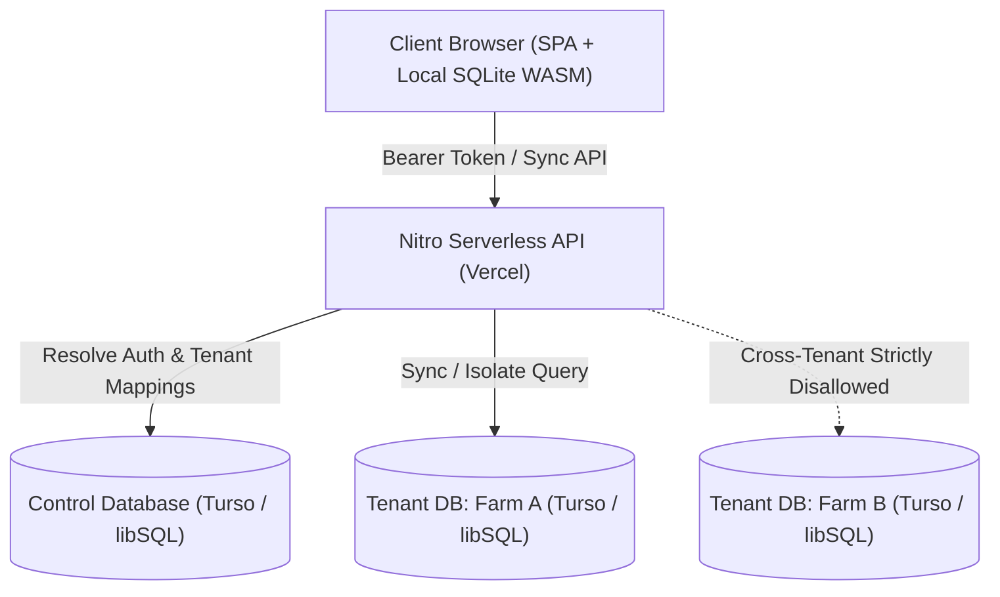

# Egg Farm Tracker — Architecture & Backend Specification (v1)

> **Purpose:** context brief for building the app in Cowork. Consolidates the architecture,
> tech stack, multi-tenancy model, and data model decided during planning.
> Companion docs: `egg-farm-app-ui-spec.md` (screens, components, flows).
> Scope: **online web app** — offline support was considered and deliberately dropped for v1.

---

## 1. What This App Is

A **multi-tenant SaaS** for chicken egg farms to track:
- **Production** — daily egg collection, by size and quality.
- **Inventory** — current sellable eggs on hand (computed, by size).
- **Sales** — eggs sold, with delivery as one fulfillment option; includes delivery status.
- **Clients** — the farm's customers (referenced by sales).

Built SaaS-first (multiple farms as tenants) even though v1 is used by a single owner-operator.
Starts as one farm's tool; designed so other farms can use it later without re-architecting.

### v1 scope
Auth · Dashboard/metrics · Production tracking · Inventory · Sales (incl. deliveries) · Client list.

### Explicitly out of v1
Customer invoicing / accounts-receivable · delivery routing/scheduling · SaaS billing (charging farms) · realtime dashboards · offline support · payment-status tracking · feed/mortality/health/flock-management.

---

## 2. Tech Stack

> [!NOTE] Architecture Migration
> The database and auth layers have been migrated from Supabase to **Firebase Auth** + **Turso (libSQL)** via **Drizzle ORM** with a **database-per-tenant** architecture.

| Layer | Choice |
|---|---|
| Frontend + backend | **Nuxt.js 4 (SPA mode, `ssr: false`) + TypeScript** — one codebase, one language |
| Server logic | **Nuxt server routes (Nitro)** — privileged ops + business logic |
| Database | **Turso (libSQL) via Drizzle ORM** (database-per-tenant architecture) |
| Auth | **Firebase Auth** (`nuxt-vuefire` on client, `firebase-admin` on server) |
| Hosting | **Vercel** (hosts Nuxt frontend + server routes) |
| UI library | **Nuxt UI v4 + Tailwind CSS v4** (see UI spec) |

### 2.1 SPA Mode (`ssr: false`) & Offline-First Client Rendering

Nuxt 4 is configured in **Single Page Application (SPA) mode (`ssr: false`)** with Service Worker precaching provided by `@vite-pwa/nuxt`.

#### Why SSR was disabled:
1. **Elimination of the Offline-First SSR Paradox**:
   In a true offline-first architecture, farm data is stored locally in the browser's Origin Private File System (`OPFS`) via SQLite WASM. An SSR server cannot access a disconnected client's device-local OPFS database to render the initial HTML. Requiring SSR would create a fatal network dependency, breaking offline access.
2. **Prevention of Hydration Mismatches**:
   SSR rendering on the server would either render an empty skeleton or attempt to fetch cloud data. When the client boots against its local OPFS SQLite state (which may contain un-synced offline production logs or sales), the resulting DOM would mismatch the server-rendered HTML, causing hydration errors and UI flicker.
3. **Instant 0ms App Shell Startup via `spa-loading-template.html`**:
   With SPA mode and `@vite-pwa/nuxt` precaching, the HTML shell, compiled JavaScript bundles, CSS, and fonts load instantly (0ms) from the Service Worker cache without hitting the network.
   - Nuxt injects [`app/spa-loading-template.html`](file:///D:/Projects/magz-egg-tracker/app/spa-loading-template.html) as the 0ms native loading template inside the root `#teleports`/`#__nuxt` mount point.
   - It is self-contained with inline CSS matching the application's `bg-muted` design token (Slate-800 `#1d293d` in dark mode, Slate-50 `#f8fafc` in light mode) and the official `AppLogo` vector egg, eliminating layout shift and dark-mode flashes.
   - The app boots immediately in offline rural barns, initializing the local SQLite WASM worker without blocking on server roundtrips.
4. **Architectural Separation of Concerns**:
   - **Client-Side (SPA + Web Worker)**: Owns 100% of UI presentation, navigation, reactive state, and isomorphic domain queries/computations against local SQLite WASM (`app/local/worker.ts`).
   - **Server-Side (Nitro Serverless Functions)**: Acts purely as an API gateway for cloud sync mutation replay (`/api/sync/push`), change data capture pull (`/api/sync/pull`), initial migration snapshot (`/api/sync/snapshot`), and tenant account provisioning (`/api/account/upgrade`).

### Why this stack
- **All-TypeScript** collapses frontend + backend into one language and gives **shared types end-to-end** via Drizzle ORM schemas.
- **Relational data** (production, sales, orders, clients, inventory with foreign keys and aggregations) fits **libSQL / SQLite** natively, enabling isomorphic schemas between local SQLite WASM in the browser and cloud Turso databases.
- **Turso (libSQL)** provides native database-per-tenant physical isolation at edge scale, combined with sub-millisecond edge replicas.
- **Firebase Auth** provides robust client-side session persistence across offline boundaries with verified server-side claims via Firebase Admin SDK.

### Stack constraints to respect at build time
- **Serverless execution model (Vercel):** Nuxt server routes run as serverless functions, not a long-running process.
  - **No persistent in-memory state or long-lived connections** — connect to Turso databases using scoped `@libsql/client` instances.
  - **Execution time limits** — keep server handlers fast and idempotent.
- **Server-only secrets:** Firebase Admin credentials (`FIREBASE_SERVICE_ACCOUNT` / `GOOGLE_APPLICATION_CREDENTIALS`), Turso auth tokens, and Turso platform tokens are **server-only** and never exposed to the client or `runtimeConfig.public` (enforced via `bun run check:build`).
- **Clients personal data privacy:** Client personal data (names, phones) are never put into logs, error messages, URLs, or SSR payloads. Repositories log SQL error codes, not raw error objects.

### Pinned versions
Nuxt **4.x** (SPA mode, `app/` directory layout with `server/` and `shared/`) · Nuxt UI **4.x** (bundles `@nuxt/fonts`, `@nuxt/icon`, and `@nuxtjs/color-mode`) · Tailwind **4** · **Firebase Auth** (`nuxt-vuefire` + `firebase-admin`) · **Turso (libSQL)** + **Drizzle ORM** · TypeScript **~6.0** · Node **24** · Vitest **5** · Bun as package manager and task runner.

---

## 3. Multi-Tenancy

**Model: Physical Database-per-Tenant with Control DB + Tenant DBs.**



### Architectural Structure:
1. **Control Database (`server/db/schema/control.ts`)**:
   - Stores global SaaS metadata: `tenants` (farms, database URLs, settings), `users` (credentials, accounts), and `memberships` (role & farm mappings).
2. **Tenant Database (`server/db/schema/tenant.ts`)**:
   - Each farm has its own physically isolated libSQL database (`file:local-tenant-<id>.db` in local development, or a dedicated Turso database in the cloud).
   - Contains tenant domain tables: `sizes`, `production`, `clients`, `orders`, `order_lines`, `sales`, `sale_lines`, and `change_log`.
3. **Defense-in-Depth Tenant Scoping**:
   - On top of physical database isolation, all queries flow through `TenantDb` / `server/repositories/`, which automatically injects `tenant_id` filters.
   - The authenticated `tenant_id` is derived on the server from the Firebase user session via `findMembershipWithFarm` (`server/repositories/memberships.ts`). Never trust a client-supplied `tenant_id`.
   - Every server route handler is guarded by `defineAuthedHandler` or `defineTenantHandler` (`server/utils/handlers.ts`).


### As built (feature 00, 2026-09-25)
- **Server DB access in v1 = `supabase-js` acting as the signed-in user** (`serverSupabaseClient(event)`: the publishable key plus the user's session cookies). PostgREST runs every query as the non-superuser role `authenticated` and `SET LOCAL`s the user's JWT claims per transaction. That is how the defense-in-depth rule above is met, and there's no privileged DB credential in the request path. A direct pooler connection with `SET LOCAL app.current_tenant` is reserved for future non-request work (cron/workers), which must then also `set local role authenticated`.
- **Tenant resolution helper:** `app.current_tenant_id()`. It's security definer, lives in the `app` schema (which PostgREST doesn't expose), and reads `memberships` by `auth.uid()`. In v1 each user has exactly one membership (`unique (user_id)`). Every RLS policy calls it as `(select app.current_tenant_id())`.
- **Repository layer:** `server/utils/db.ts` → `TenantDb.scoped(table)` pre-applies `.eq('tenant_id', …)` to select/update/delete and injects `tenant_id` into inserts. Routes use `defineTenantHandler` / `defineAuthedHandler` (`server/utils/handlers.ts`), and only repositories touch the client.
- **Service role at runtime:** none in v1. The secret key is used only by the local provisioning CLI (`server/cli/provision.ts`) and isn't configured on Vercel.
- **Multi-statement atomic writes** are Postgres functions (`security invoker`) called through `rpc`, so each one runs as a single transaction. *(Feature 01)* Repositories call them through `TenantDb.rpc(fn, args)`, which injects `p_tenant_id` from the server context (never from the request). Every such function first calls `app.assert_tenant(p_tenant_id)`, which raises unless it equals `app.current_tenant_id()`, so RLS **and** the repository filter must agree, as for table queries. Domain errors use custom SQLSTATEs (`TM001`…, never the `PT` prefix), which repositories map to `ApiErrorData`. Reads that could exceed PostgREST's `max_rows` (1000) aggregate in SQL and return a single `jsonb` value.
- **Tables written by `security invoker` functions need write grants, so the rules live in the database *(feature 02, designed 2026-09-26)*.** An owner who can call `add_size` must be able to write `sizes`, and the browser holds the same JWT, so PostgREST can reach the table directly. Such a table therefore gets (1) **column-level grants** (only the columns an owner may set; never `tenant_id`, never a delete), (2) `BEFORE` row triggers that normalise, assign or reject, and (3) a statement-level `AFTER` trigger for cross-row rules (a farm keeps one active size). Functions add friendly errors, idempotency and conflict checks on top, and take a per-farm `pg_advisory_xact_lock` to serialise writes. Never `security definer` to get around this.
- **API errors *(feature 02)*.** `ApiErrorCode` gains `conflict` (409). `ApiErrorData` gains optional `reason` (`name_taken`, `last_active_size`, `sizes_changed`), `existing` (the size that has the name) and `sizes` (the farm's current sizes, attached to a conflict so the client refreshes without a second request). Domain SQLSTATEs continue the `TM…` list (`TM008`–`TM015`).
- **Clients: the first personal data *(feature 03, designed 2026-09-26)*.** Same write pattern as sizes (owner column grants, `BEFORE` trigger for normalise/validate/cap, CHECKs behind it, `security invoker` functions, per-farm advisory lock, no delete), plus rules that exist because names and phones are personal:
  - **Nothing personal in logs, messages or URLs.** Postgres error details carry row values (`23505` the key, `23514` the whole failing row), so the clients repository never logs an error object (only `[clients] <scope> <SQLSTATE>`), the functions' exception messages are fixed strings (a name clash's `detail` is an id, not a name), and the server's own field message for a clash has no value. The list is fetched by the browser after mount and is **never** in `/api/me` or the SSR payload; the search is client-side and never reaches the server or the URL; `useMe().clear()` also clears `clients:*` client state, and that state is keyed by farm id.
  - **Error contract additions.** `ApiErrorReason` gains `client_limit` and `client_changed`; `ApiErrorData.existing` is the general `NameMatch { id, name, archived }` (sizes' `SizeNameMatch` is an alias) and `ApiErrorData.client` carries the current row on a stale edit. SQLSTATEs continue after `TM016`: `TM017` name, `TM018` phone, `TM019` price (the `hint` names the reason), `TM020` name taken, `TM021` 500 clients, `TM022` client changed, `TM023` not this farm's client (404, identical for "not yours" and "unknown"), `TM024` submission reused with another payload, `TM025` immutable column, `TM026` ledger cap.
  - **Text rules in the database too.** A name or phone with a control or invisible character (zero-width space/joiner, bidi marks, soft hyphen, tag characters) is refused by the trigger and a CHECK, not only by zod; raw input over 200 characters is refused before it is normalised (feature 02 audit M-1, M-2, L-1, L-3 applied up front). A name or phone must also hold at least one letter, number, symbol or punctuation character (Unicode L, N, S, P, except U+FFFC), so a lone combining mark, private-use or unassigned code point is refused with the same "hidden character" message (`app.client_text_visible`, explicit ranges from Unicode 17.0 because Postgres regexes have no property classes; parity-tested against `hasVisibleClientTextChar` over every code point). A cap on combining marks is not done. Widening any refused set once data exists needs a data migration first: the CHECK constraints re-run on every update of a row, so a legacy row would fail even on archive or restore.
  - **Currency.** `tenants.currency` (ISO code, `^[A-Z]{3}$`, default `PHP`) rides on `/api/me` (`FarmSummary.currency`); owners can't write it. One helper, `shared/utils/price.ts`, formats every price (fixed `en-US` locale, symbol first, 2 decimals, thousands separator, unknown or missing code falls back to `PHP`).
- **Sales: header + lines, sale numbers, and the one place on-hand is computed *(feature 04, designed 2026-09-27)*.** `sales` + `sale_lines` follow the sizes/clients write pattern (owner column grants including a real `delete` grant on `sales`/`sale_lines`, matching `production`'s precedent rather than clients'/sizes' "never deleted"; `security invoker` functions; a per-farm advisory lock, `app.lock_tenant_sales`, that also serialises sale-number assignment and the stock-shortfall check for that farm). See `docs/features/04-sales.md` §3 for the full table shapes, the `create_sale` / `update_sale` / `mark_sale_delivered` / `mark_sale_pending` / `delete_sale` functions, the SQLSTATEs (continuing after `TM026`), and the sale-number counter table (`sale_counters`, one row per tenant, incremented under the per-farm lock — not a Postgres `SEQUENCE`, which would need one per tenant and breaks the shared-tables model). `app.on_hand_json` is the one place on-hand-by-size is computed; both Sales (the per-line hint and the shortfall check) and the future Inventory screen (feature 06) call it.
- **RLS policy template for every tenant-owned table:**
  ```sql
  alter table public.<t> enable row level security;
  revoke all on public.<t> from anon;
  create policy <t>_select on public.<t> for select to authenticated using (tenant_id = (select app.current_tenant_id()));
  create policy <t>_insert on public.<t> for insert to authenticated with check (tenant_id = (select app.current_tenant_id()));
  create policy <t>_update on public.<t> for update to authenticated using (tenant_id = (select app.current_tenant_id())) with check (tenant_id = (select app.current_tenant_id()));
  create policy <t>_delete on public.<t> for delete to authenticated using (tenant_id = (select app.current_tenant_id()));
  ```
- **Isolation test:** pgTAP in `supabase/tests/database/`, run with `bun run test:db`. A new table adds one row to `tests.tenant_table_registry()`, and the shared A-vs-B checker covers it. A coverage meta-test fails if any `public` table is missing RLS, `tenant_id`, `updated_at` or its registry row.

### Where the client/server line is drawn
- **Ordinary reads/writes** may go through `supabase-js` with RLS protecting them.
- **Nuxt server routes** own: privileged operations (service-role), business logic & derived metrics (inventory, dashboard figures, any anomaly flags), tenant provisioning, and anything that must not live in the client or a SQL policy.
- **RLS stays on regardless**, as the database-level backstop.

---

## 4. Canonical Unit: Individual Eggs

**All quantities are stored as individual egg counts.** Trays are a display/input convenience only.

- Eggs are the indivisible atomic unit — they divide cleanly and need no conversion for production or inventory math. (Storing in trays would force fractional trays, e.g. 207 eggs = 6.9 trays, and lose remainders.)
- **Eggs-per-tray is a per-tenant setting** (defaulted in v1, e.g. 30). Stored as tenant config — **never hardcoded** — so per-farm tray sizes are possible later without migration.
- **Conversion happens only at the edges** (input and display), never in the stored data or inventory math. The frontend converts using a single shared helper; the database only ever holds egg counts.
- **History-proof:** because sales store egg counts, changing a farm's tray size later doesn't corrupt past records — only the display changes.

---

## 5. Data Model

Core domains: **Production**, **Inventory** (computed), **Sales** (absorbs deliveries), **Clients**, plus tenant/user tables. Every table carries `tenant_id`. Consider `updated_at` on every table (useful for "recently changed" queries and a cheap hedge that keeps a future sync/offline layer unblocked).

### Tenant tables (built in feature 00)
- **`tenants`** `(id uuid pk, name text 1–100 chars, eggs_per_tray integer not null default 30 check (>= 1), currency text not null default 'PHP' check (~ '^[A-Z]{3}$') /* feature 03 */, created_at, updated_at)`. It's the **root**: its `id` *is* the tenant id, so it has no separate `tenant_id` column. It's the one named exception to "every table has `tenant_id`", and it's still RLS-filtered by `id`.
- **`memberships`** `(id, tenant_id → tenants, user_id → auth.users, created_at, updated_at, unique (user_id))`: one farm per user in v1.
- Owners have **read-only** access to both tables (no write grants and no write policies). Farms and memberships are created only by provisioning (the Admin API plus service-role-only SQL functions).

### Design principle: categories are data, not columns
Size, quality, and fulfillment type are **data**, not fixed columns (no `large_count`, `jumbo_count`). Totals are `SUM`/`GROUP BY`, not hand-summed columns.
- **Sizes are per-farm rows** (owner decision, feature 01): each farm has its own ordered list in `sizes`, and rows reference it by `size_id`. Adding, renaming or reordering a size is a row change, never an `ALTER TABLE`, and never a code change. The app never hardcodes the list.
- **Quality and fulfillment type are column values** (`text` + check constraint). A new one is a new allowed value.

### Sizes (built in feature 01)
- **`sizes`** `(id, tenant_id → tenants, name text 1–40 chars, sort_order int >= 0, color_slot smallint >= 0, archived_at timestamptz null, created_at, updated_at)`, with `unique (tenant_id, id)` (the composite-FK target), a unique name per farm (case-insensitive), and a unique `color_slot` per farm (a colour is never reused, so archived sizes keep theirs in past charts).
- Seeded with **Small, Medium, Large, Jumbo** (slots 0–3) by a trigger on `tenants` insert (`app.seed_default_sizes`), and backfilled for existing farms by the migration. The default list lives only in that function.
- **Never deleted.** Retiring a size sets `archived_at` (the "Farm settings: sizes" feature). Past production keeps pointing at it, and a rename relabels past days without changing counts.
- The size list is sent with the farm in `GET /api/me` (`FarmSummary.sizes`), and `GET /api/sizes` re-reads it.
- **Management (feature 02, designed 2026-09-26)**: add, rename, reorder, archive and restore, each one `security invoker` function (`add_size`, `rename_size`, `reorder_sizes`, `archive_size`, `restore_size`) plus the `size_submissions` idempotency ledger for add. Owners have `select`, `insert (tenant_id, name)` and `update (name, sort_order, archived_at, updated_at)` on `sizes`, and **no delete, ever**.
  - Names are stored normalised (NFC, whitespace runs collapsed, trimmed; 1–40 characters) and stay unique across archived sizes, so a retired name is not reusable (restore instead).
  - **Colour slot and position are assigned by a `BEFORE INSERT` trigger**: the smallest slot not used by any of the farm's sizes (archived included), so a colour never repeats until the ten-colour palette is used up, is never red (the palette has no red), and never changes; new sizes go last. `sort_order` is kept compact, **active sizes first**, then archived in their previous order.
  - A farm always keeps one active size: a statement-level trigger refuses any update that would leave none, whatever the path. Archived sizes keep their past production, are not offered for new eggs (`production_bounds`, `log_production`), and can be restored (to the end of the active list).
  - At most 100 sizes per farm (archived included), so `/api/me` stays bounded (proposed; pending owner confirmation, feature 02 §3.9 Q2).

### Production
Shape: **`(produced_on, size_id, quality, eggs)`** + `tenant_id` (as built in feature 01; the planning names were `date, size, quality, count`).
- **produced_on**: the owner's local calendar date (a `date`, sent by the device).
- **size_id**: a row of the farm's `sizes`. **Nullable**: null means "size doesn't apply", used only for rejects. A composite FK `(tenant_id, size_id) → sizes (tenant_id, id)` guarantees it's the same farm's size.
- **quality**: `good` / `reject` (extensible: dirty, etc.). Always present.
- **eggs**: individual eggs, `between 1 and 1000000` (`production_eggs_range`; the upper bound equals `MAX_EGGS_PER_LINE` in `shared/constants/production.ts`). Zero amounts aren't stored.
- **Table-level bounds hold for every write path**, including direct PostgREST writes with the owner's JWT. The `production_bounds` trigger (`before insert or update`) enforces:
  - `produced_on` not after UTC today + 1 (TM002);
  - the per-line cap (TM007);
  - a good row's size is **active** (TM001), unless that size already has a row on the same farm-day (an update to an existing line, which lets Edit day correct a day holding a since-archived size). On UPDATE, the size must be active only if the row's size, date, quality or tenant changes.
- **Good eggs are always sized and rejects are always unsized** (owner decision, 2026-09-25): check `(quality = 'reject') = (size_id is null)`. Sized or graded rejects ("cracked large") aren't in v1. If they're added later, this check is relaxed and a sized-reject row still never enters inventory.
- **One row per (farm, date, quality, size)** (`unique nulls not distinct`). Logging a date again **adds** to that day's rows (upsert). Edit day **replaces** the day's rows, and Delete day removes them by date. All three are single `security invoker` functions, so each save is all-or-nothing. An "add" carries a client-generated submission id recorded in `production_submissions`, so a retried save never counts twice.
- A morning's collection = several rows, e.g. `Large/good/264`, `Medium/good/148`, `(null)/reject/5`.

### Rejects
- **A dead end.** Tracked at production (so the farm knows its loss/quality rate) but **never enter sellable inventory and are never sold.**
- Reject rows: `size_id = null`, `quality = reject`. One unsized amount per day.

### Inventory
- **Computed, not stored** — on-hand = (sellable eggs produced) − (eggs sold). No stored running figure to drift out of sync.
- **Tracked by size** (by the farm's `sizes`: large on hand, jumbo on hand, …), because sales are sized. On-hand = `sum(production.eggs) where quality = 'good' group by size_id` minus the eggs of non-voided sales by `size_id` *(feature 05: every sale is a real, completed transaction, so there is no status test)*.
- Only **good** production counts; rejects excluded.
- **On-hand = physically present right now.** Inventory subtracts **when a sale is logged**, i.e. when the eggs actually leave. **Orders never change it** *(feature 05)*: an order is a promise, not a sale, and reserves nothing. If "available to promise" is ever needed, that's a separate computed notion (on-hand minus open orders' remaining) — not in v1.
- **Owed on open orders** *(feature 06, designed 2026-10-07)*: the eggs still owed per size = for each open order (`requested`/`confirmed`/`ready`/`partially_fulfilled`, not closed short, not cancelled) `greatest(ordered − non-voided delivered, 0)` summed by size (`app.owed_by_size`, the same rule as `order_json`'s `remainingEggs`, kept in step by a pgTAP parity test). It is **information only**: shown beside on-hand, never subtracted from it, and no "Sellable"/reserved figure exists.
- **On-hand can be negative.** `app.on_hand_json` does not clamp: an overridden shortfall ("Record anyway"), a backdated sale or an edited/deleted production day can leave a size below zero. The Inventory screen shows the true value with a note; nothing clamps it in SQL or the API.
- **`GET /api/inventory`** → `get_inventory` → `app.inventory_json`: one read-only payload `{ hasAny, sizes[{ id, name, sortOrder, colorSlot, active, onHandEggs, owedEggs }] }` built from `app.on_hand_json` + `app.owed_by_size`. Every active size, plus an archived size only while its on-hand or owed is non-zero. No new table, column or index.

### Sales (absorbs Deliveries; header + lines, designed 2026-09-27, feature 04)
The tracked entity is a **sale**; **delivery is one fulfillment method**, not a separate concept. Some sales are delivered to a client; some are on-site/home sales with no delivery. **Owner decision (2026-09-27, feature 04 Q1): a sale is an order — one header plus 1 to 20 lines** (one per egg size), because the owner plans to print an invoice from one sale. This replaces the single-row planning shape below it (the old shape assumed one size per sale; the actual build is `sales` + `sale_lines`, `docs/features/04-sales.md` §3.1).

> **Revised by feature 05 (Orders, designed 2026-10-03; `docs/features/05-orders.md` §3).** Pending sales are gone: the intent to deliver is an **order** (see "Orders" below) and every sale is a real, completed transaction. The header below is as it stands after feature 05; the struck concepts (status, null `delivered_date`, mark-delivered, hard delete) are described only in the history notes.

**Header (`sales`), roughly:** `(id, tenant_id, sale_number, client_id, type, sale_date, delivered_date, order_id, version, voided_at, created_at, updated_at)`
- **sale_number** — a whole number, unique per farm, assigned by the database when the sale is logged (never by the client), in the order sales are logged (not by `sale_date`), never reused (a sale is never deleted; the numbers of converted pending sales are retired by the forward-only `sale_counters`). It becomes the invoice number in the invoice feature.
- **sale_date** — **the day the eggs left** (the owner sees one date). Always set, never in the future.
- **delivered_date** — a **generated** copy of `sale_date` (`generated always as (sale_date) stored`), so it is never null and can never differ. Null no longer means pending. Candidate for removal in a cleanup.
- **status** — **removed in feature 05.** There is no `pending` sale. The only per-sale lifecycle left is `voided_at` (one-way).
- **order_id** — nullable composite FK `(tenant_id, order_id) → orders (tenant_id, id)`, **not unique** (many deliveries per order); set only by `deliver_order`. A linked sale's client, type and lines are locked (void and re-deliver to change eggs); its date can change.
- **type** — `delivery` / `on_site`. **Editable after logging** for a direct sale (feature 04 AC64–AC66, simplified by feature 05 to a plain edit: stock never moves because of a type change). A sale made from an order is always a delivery to the order's client. `pickup` is **not** planned; on-site covers it.
- **client_id** — **nullable**, composite FK `(tenant_id, client_id) → clients (tenant_id, id)`; required for a delivery, optional for an on-site sale (no fake "walk-in" record needed).
- **version** — the stale-edit marker (as `clients.version`).

**Lines (`sale_lines`), roughly:** `(tenant_id, sale_id, size_id, eggs, price_per_tray, line_total, created_at, updated_at)`, primary key `(tenant_id, sale_id, size_id)` (so a size can't appear twice in one sale; a sale's own lines are always looked up as a set, never by a separate line id).
- **size_id** — the egg size sold (sales are always sized; rejects never sold), from the same per-farm `sizes` list, with the same composite `(tenant_id, size_id)` FK as production.
- **eggs** — stored in **individual eggs** (frontend accepts trays/loose, converts).
- **price_per_tray**, **line_total** — **both snapshotted onto the line** at save time (feature 04 AC55/SL2): `line_total` is computed once, from the price, the eggs and the farm's `eggs_per_tray` *at that moment*, and frozen — a later change to the farm's tray size or currency never changes a saved line's total (it only changes how a farm's *current* prices are entered). A client's default price may *pre-fill* the form but is **not** authoritative for historical sales. The sale total is the sum of the lines' `line_total` (never stored, computed at read time — a sale has at most 20 lines).

**Derived views (no separate tables/screens):**
- "Deliveries" = `WHERE type = 'delivery'`; "deliveries of an order" = `WHERE order_id = …`.
- "Outstanding / for delivery" is **not a sales view any more**: it is the remaining on open **orders** (see Orders).

**The single event.** Logging a sale (directly, or via `deliver_order`) is one transaction that takes a sale number, writes the header and every line, and thereby decrements inventory for every line. There is nothing to "complete" later. The only later correction is Edit (direct sales; date only for a linked sale) or **Void** (`voided_at`, one-way: the row and its number stay, its eggs return to stock). **A sale is never deleted**: no delete grant, policy, function or route.

*History (feature 04, superseded by 05):* a sale used to carry `status` (`pending`/`complete`) with `delivered_date` null while pending, a `mark_sale_delivered` completion event, and a hard delete for pending sales. Feature 05 moved that intent into orders.

**Why one status field (not two).** Orders carry the only status (`orders.status`). A second axis would only be introduced for payment tracking (e.g. `payment_status`), out of v1 scope. `voided_at`, `orders.cancelled_at` and `orders.closed_short_at` are one-way flags, not status values.

**On-hand, shared with the future Inventory feature (feature 06).** One `security invoker` function (`app.on_hand_json`, `docs/features/04-sales.md` §3.1, simplified by feature 05) computes good production minus non-voided sales' eggs, grouped by size — the one place this is calculated, called by Sales' per-line hint and shortfall check and the Deliver step now, and by Inventory's screen later. A printable invoice of one sale (no payment status) is the invoice feature (renumbered 07 by feature 05); Inventory (per-size stock, "for delivery" from open orders) is feature 06.

### Orders (feature 05, designed 2026-10-03)
An **order** is a promise to deliver; a sale is eggs that have left. Full design: `docs/features/05-orders.md` §3.
- **`orders`** `(id, tenant_id, order_number, client_id not null, order_date, wanted_by null, status, cancelled_at, closed_short_at, converted_from_sale_number, version, …)` + **`order_lines`** `(tenant_id, order_id, size_id, eggs, price_per_tray, line_total, dropped_eggs)` with primary key `(tenant_id, order_id, size_id)` (1–20 lines, deferred bounds trigger) + **`order_counters`** (per-farm order numbers, never reused, independent of sale numbers) + **`order_submissions`** (the `create_order` idempotency ledger; `deliver_order` reuses `sale_submissions`). Composite same-farm FKs to `clients` and `sizes`. Orders are **never deleted** (no grant/policy/function/route).
- **Status** (one field): `requested → confirmed → ready` (free movement among the three while nothing is delivered), then `partially_fulfilled` / `fulfilled` set **only by deliveries**, plus `cancelled` (only with no non-voided delivery). `closed_short_at` marks a partially fulfilled order closed short (shown "Fulfilled (closed short)"; one-way). Voiding the last non-voided delivery sends the order back to `ready`; a closed-short order stays closed.
- **Delivered-so-far and remaining are computed** from the order's non-voided linked sale lines (`app.order_delivered_eggs`), never stored. The only stored derived fact is `dropped_eggs`, written once at Close short.
- **A delivery is a sale** (`type = delivery`, `order_id` set, the order's client, the order line's frozen price) created by `deliver_order`: cap at remaining, stock check with an allow-anyway flag, sale number, status, all in one transaction. Over-delivery is refused; extra eggs are a direct sale.
- **The database keeps status honest**: `orders_write_guard` refuses a status that disagrees with the deliveries, and a trigger on `sales` recomputes the order when a delivery is voided, so a hand-built write cannot jump an order to Fulfilled.
- **Orders never change on-hand** and reserve nothing. Inventory "owed on open orders" (feature 06) and the later Dashboard "pending deliveries" read open orders' remaining through `app.owed_by_size`.
- **Conversion of existing pending sales** is a one-time, idempotent, all-or-nothing data migration (status `confirmed`, new order numbers in old sale-number order, `converted_from_sale_number` kept, old sale numbers retired).

### Clients (built in feature 03, designed 2026-09-26)
- A simple **per-tenant list of the farm's customers** (shops/restaurants/individuals). NOT the SaaS's tenants. First table with real-world PII → first isolation-test target (reads **and** writes).
- **`clients`** `(id, tenant_id → tenants, name text 1–60 chars, phone text null (≤ 30), default_price numeric null, archived_at timestamptz null, version bigint, created_at, updated_at)`, with `unique (tenant_id, id)` (**the composite-FK target Sales references** as `(tenant_id, client_id)`, never cascading) and a unique index on `(tenant_id, lower(name))`.
  - **Fields (owner decision):** name (required), phone (free text, optional), default price (optional). No address or notes in v1.
  - **Name:** stored normalised (NFC, whitespace runs collapsed, trimmed; the same rule as sizes). Unique per farm **including inactive clients**, ignoring case and spacing but **not accents** ("Cafe" and "Café" are different names). Search and sort ignore accents, in the browser (`shared/utils/client-list.ts`), not in SQL.
  - **Phone:** trimmed only, no format enforced; empty is null.
  - **Default price:** the price the owner usually charges **per tray**, in the farm's currency, stored as unconstrained `numeric` with checks (`> 0`, `<= 9999.99`, `= round(price, 2)`); a typmod would round silently. It only pre-fills a sale; each sale keeps its own price. The limits are currency-independent for now.
  - **Inactive, never deleted.** `archived_at` set = inactive (the UI says "Inactive"; "archive" is the internal word). No delete grant, policy, function or route. Marking inactive/active is idempotent and always allowed (even with pending deliveries); an inactive client keeps its past sales and is not offered for new sales.
  - **A sale does not snapshot the client's name.** A sale stores `client_id` and its own price snapshot; renaming a client shows the new name on past sales (owner decision, feature 03 Q7). Because clients are never deleted, `client_id` always resolves.
  - **Limits, in the database:** at most **500 clients per farm** (inactive included; trigger, `TM021`); a version marker (`version`, bumped on every real change) for the stale-edit check.
  - **Writes:** `add_client` (idempotent through the `client_submissions` ledger, which stores a SHA-256 of the normalised payload, so a replay with another payload is refused), `update_client` (checks `version`), `archive_client`, `restore_client`: all `security invoker`, `p_tenant_id` asserted, one per-farm advisory lock. Owner grants: `select`; `insert (tenant_id, name, phone, default_price)`; `update (name, phone, default_price, archived_at, updated_at)`; nothing else.
- Referenced by sales via nullable `client_id` (null = on-site sale; there is no "Walk-in" client row).
- Sales picker offers **active** clients only, and reuses the Add client form (feature 03 AC34).

### Invoice (feature 07, designed 2026-10-07)
A **printable invoice** is a read-only page for one sale, `/sales/:id/invoice` (opaque id only in the address). Full design: `docs/features/07-invoice.md` §3.
- **No new data, no migration, no new server route.** The page reads `GET /api/sales/:id` (`get_sale`: header, frozen lines, voided or not; another farm's id and a missing id both answer 404), the farm's name, eggs-per-tray, currency and sizes from the existing `me.farm` (`useFarm`), and, for a sale with a client, the client's name from the client list that `useClients` fetches on the client. A sale still carries only `clientId`, never a name, and nothing personal is added to `/api/me`, the SSR payload or any response.
- **Invoice number = the sale number**, shown plainly as `#1042` (no prefix; a prefix or numbering setting is a later feature). Everything printed is frozen on the sale (egg counts, `price_per_tray`, `line_total`, sale total); only names (client, size, farm) and the tray split of the egg count follow the farm's current settings.
- **Print is the browser's**: a **Print** button calls `window.print()` (never automatic on load: iOS Safari only honours it from a tap), and Save as PDF is the browser's. The app builds no PDF and sends nothing. A voided sale prints with a text VOID mark and is never presented as valid. No payment, tax, due date, balance, address or logo.
- **Privacy:** the page title and suggested PDF file name are `Invoice {number}`; the sale and client name live only in the page's local state (not `useState`, not the SSR payload, no storage, no logging), fetched after mount.

---

## 6. Dashboard / Metrics

Keep tightly scoped — a small, fixed set (no configurability in v1):
- Today's / this week's production (eggs, by size).
- Current on-hand inventory (by size).
- Recent sales / deliveries.
- Outstanding deliveries = remaining on **open orders** (feature 05; sales have no pending state).
- Optionally lay rate (eggs ÷ hen count) — only if hen counts are tracked.

---

## 7. Realtime (deferred)

Not required for v1 (daily collection is low-frequency; manual refresh/polling suffices). If added later:
- **Push from the write path** — all writes flow through the Nuxt server, the natural broadcast point (e.g. WebSockets on a persistent-server deployment). Fits the centralized-writes design.
- Postgres `LISTEN/NOTIFY` for change signals not originating in the app.
- Logical replication / CDC (what Supabase's own realtime uses) — heavyweight, almost certainly unnecessary here.
- Note: Supabase's built-in realtime rides the data-API path; a server-centric architecture trades that for control, hence the WebSocket fallback.

---

## 8. Build Order

The data model (the expensive-to-reverse part) is settled. Remaining work is mechanical translation:
1. **Schema** — tables, columns, foreign keys, `tenant_id` on every table (and `updated_at`).
2. **RLS policies** — enforce tenant isolation; write the cross-tenant isolation test.
3. **Supabase Auth wiring** — JWT validation in Nuxt server, user↔tenant mapping, tenant-resolution middleware.
4. **Repository/query layer** — centralized `tenant_id` scoping; connect via Supabase pooler.
5. **Server routes** — CRUD + business logic (inventory computation, dashboard metrics).
6. **Frontend** — production entry, sales/deliveries, clients, dashboard; tray↔egg conversion helper. (See UI spec.)

---

## 9. Carry-Forward Rules (all decided — easy to lose)

- **`tenant_id` on every table** from the first migration; **RLS on**, even when routing through the server.
- **Derive tenant server-side**; never trust the client.
- **Cross-site writes are refused in the handler wrappers** (security audit L1; `SameSite=Lax` alone is not the CSRF defence). `defineTenantHandler` and `defineAuthedHandler` call `assertRequestAllowed` before any auth or database work; the decision is the pure `checkRequest` in `server/utils/request-guard.ts`. For POST, PUT, PATCH and DELETE: a `Sec-Fetch-Site` that is present and not `same-origin` or `none`, or an `Origin` that is present and doesn't match the request host (`Host` or `X-Forwarded-Host`), is a 403 with code `no_farm` (the only 403 code; no new contract); a request with a body that isn't `application/json` is a 400 `validation_failed`. A header that is absent never blocks (curl, scripts, the CLI, SSR-internal calls); GET, HEAD and OPTIONS are not checked. The frontend `$api` (ofetch) already sends same-origin headers and JSON.
- **Service-role key server-only**; browser uses anon key + RLS.
- **Connect via Supabase connection pooler** (serverless + Postgres).
- **Canonical unit = eggs**; trays are display/input only; **eggs-per-tray is a per-tenant setting** (defaulted, not hardcoded).
- **Inventory = physically on-hand**; subtract **at delivery/completion**.
- **Price snapshot on sales** — store on the sale **line**, not a live client lookup, and freeze the computed `line_total` too so a later tray-size or currency change never changes a saved total (feature 04 AC55). (The client's *name* is not snapshotted: a rename shows on past sales.)
- **Prices are plain numbers shown in a per-farm currency** (`tenants.currency`, default `PHP`), formatted by the one `formatPrice` helper; a currency change relabels stored prices and never converts them. Never type a currency symbol into a screen.
- **Nullables are meaningful:** `size_id` null (rejects), `client_id` null (on-site sales). *(Feature 05: `delivered_date` null no longer means pending; there is no pending sale. An order's `wanted_by` null = no date wanted.)*
- **Categories as data** (size, quality, fulfillment_type are values, not columns). **Sizes are per-farm rows** in `sizes`, referenced by `size_id` with a composite `(tenant_id, size_id)` FK; never hardcode the list. **Rejects are always unsized.**
- **One `status` field** in v1, on **orders** (`requested`/`confirmed`/`ready`/`partially_fulfilled`/`fulfilled`/`cancelled`); sales have none (feature 05). Add a second axis only when payment arrives.
- **Sales are void-only; orders are cancel/close-only.** No sale and no order is ever deleted. Delivered-so-far on an order is computed from its non-voided deliveries, never stored.
- **The invoice is a read-only view of one saved sale** (feature 07): no new data, no payment fields, nothing in the address, title or file name but the opaque sale id and the sale number; the client's name is joined on the client from the client list and never stored on the sale or sent by the server.
- **`updated_at` on every table** — cheap hedge; do not design *against* a future offline/sync layer.

---

## 10. Notes for Cowork

- This spec reflects the **planned** architecture from the design conversation. If the actual codebase has diverged, treat the code as source of truth and update this doc to match rather than the reverse.
- Two implementation conventions were left to build-time (both noted in the UI spec): the exact **quantity input convention** (two fields vs decimal-trays; decided in feature 01) and **client delete = soft-delete/archive** behavior (decided in feature 03: never deleted, marked inactive with `archived_at`).
- Real values still needed from the owner: actual **tray size** (eggs per tray) and whether **hen counts** are tracked (drives the optional lay-rate metric).
  - *Update 2026-09-25:* the owner chose **30 eggs per tray** as the farm default (the `tenants.eggs_per_tray` column default) and **trays + loose as two fields** for quantity entry. Hen counts are still open.
